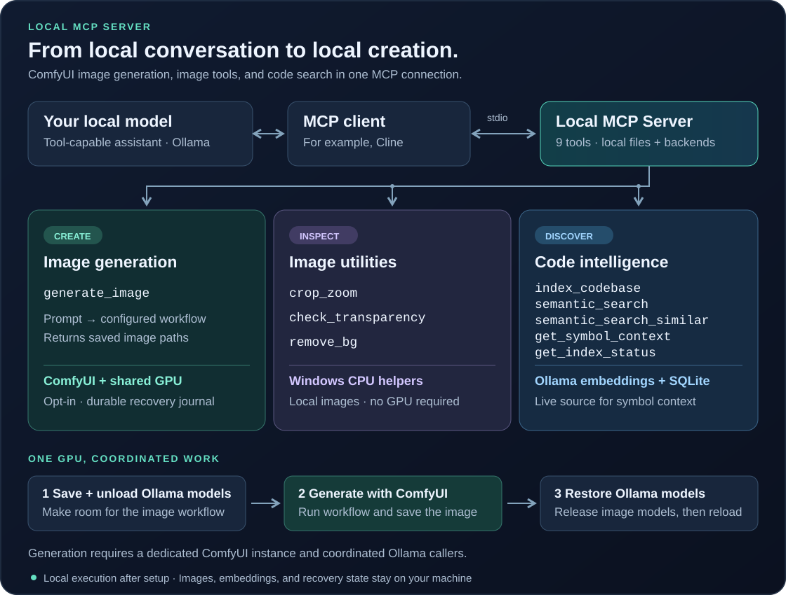

# Local MCP Server

**Give your local AI model the ability to generate images with ComfyUI.**

Cloud assistants can do more than chat: they can use tools to create images and
work with your code. This MCP server brings those capabilities to local models,
taking them one step closer to keeping up with cloud models while the work stays
on your machine. Connect a tool-capable local model through an MCP client such as
Cline, and it can generate an image, inspect the details, check transparency,
remove a white background, and search your codebase by meaning.

ComfyUI runs the image workflow. Ollama runs your local models. This server
connects them and coordinates GPU memory: it saves the list of running Ollama
models, unloads them for image generation, then reloads them when the job ends.
Once the dependencies and model files are installed, these tools can run locally
without a cloud inference API.



[Get started](#get-started) · [All tools](#mcp-tools) ·
[Image setup](workflows/README.md) · [Tool reference](docs/tool-reference.md) ·
[Development](#development)

## What it adds to your local assistant

- **Image generation through ComfyUI.** Run a configured local workflow from a
  prompt, with durable job tracking and Ollama model restoration.
- **Image inspection and cleanup.** Enlarge selected details, measure real alpha
  transparency, and turn a border-connected white background into a new cutout PNG.
- **Code search by meaning.** Find implementations from a description, look for
  similar code, and inspect live symbols before editing.
- **Structural code navigation.** Trace imports, calls, inheritance, and engine
  components, or inspect live file interfaces with the
  [structural graph tools](docs/structural-graph.md).
- **Local storage.** Images stay in your ComfyUI output directory; code embeddings
  live in a SQLite database inside each indexed project.

## Get started

### 1. Install the server

Use **Python 3.10+**; development and CI use Python 3.13. The image inspection
tools require **Windows PowerShell and System.Drawing** on the server machine.
The commands below use Windows PowerShell.

```powershell
git clone https://github.com/stevemtg/local-mcp-server.git
cd local-mcp-server
py -m venv .venv
.\.venv\Scripts\python.exe -m pip install -r requirements.txt
```

For semantic search, install [Ollama](https://ollama.com), start it locally, and
download the embedding model:

```powershell
ollama pull nomic-embed-text
```

For image generation, you also need a dedicated local
[ComfyUI](https://github.com/Comfy-Org/ComfyUI) instance, an API-format workflow,
the model files and nodes that workflow uses, and enough GPU memory to run it.
The repository includes three [example workflows](workflows/README.md); model
weights are downloaded separately.

### 2. Connect your MCP client

Add this entry to your client's MCP settings. In Cline, open the MCP server
configuration. Replace `C:/path/to/local-mcp-server` with your actual clone path.
Use the virtual environment's interpreter so the client finds the dependencies.

```json
{
  "mcpServers": {
    "codebase-semantic-index": {
      "command": "C:/path/to/local-mcp-server/.venv/Scripts/python.exe",
      "args": ["-B", "C:/path/to/local-mcp-server/server.py"],
      "env": {
        "OLLAMA_URL": "http://localhost:11434",
        "EMBED_MODEL": "nomic-embed-text"
      }
    }
  }
}
```

The connection name `codebase-semantic-index` is retained for existing clients.
The server uses stdio; the MCP client launches it. Configure your conversational
model in the client separately from the server's embedding model.

### 3. Enable ComfyUI image generation

`generate_image` is enabled only when `IMAGE_MODEL` and its required settings are
configured. Add the following keys to the server's `env` above. This example uses
the bundled SDXL workflow; replace the paths, chat model, context size, and VRAM
budget with values for your machine.

```json
{
  "IMAGE_MODEL": "your-ollama-chat-model:tag",
  "IMAGE_LOAD_OPTIONS": "{\"num_ctx\":8192}",
  "IMAGE_WORKFLOW_PATH": "C:/path/to/local-mcp-server/workflows/image-simple.json",
  "IMAGE_OUTPUT_ROOT": "C:/path/to/ComfyUI/output",
  "IMAGE_STATE_ROOT": "C:/path/to/local-mcp-server/.image-orchestration",
  "IMAGE_VRAM_BUDGET_BYTES": "8589934592",
  "IMAGE_POSITIVE_NODE": "6",
  "IMAGE_NEGATIVE_NODE": "7",
  "IMAGE_SAMPLER_NODE": "3",
  "IMAGE_SAVE_NODE": "9"
}
```

`IMAGE_MODEL` is the exact Ollama **chat** model name, and `IMAGE_LOAD_OPTIONS`
must match the host's load options, including `num_ctx`. The 8 GiB budget above
is an example, not a measured requirement for every workflow. `IMAGE_OUTPUT_ROOT`
must already exist and match ComfyUI's actual output directory. Ollama and ComfyUI
default to loopback ports **11434** and **8188**.

Install `AnythingXL_xl.safetensors` for this example, or change the workflow's
checkpoint name to an installed compatible SDXL checkpoint. Follow the
[workflow guide](workflows/README.md) for Qwen Image and Krea alternatives.
Reconnect the MCP client after updating the configuration. Set its tool timeout
long enough for unloading, generation, and restoration together.

**GPU coordination matters:** use a dedicated ComfyUI instance and pause other
applications' Ollama requests during generation unless they participate in the
shared GPU lease. The server coordinates its own embedding calls but cannot
pause another application's inference requests. See
[image generation and recovery](docs/image-generation.md) for the complete contract.

Without these image settings, the eight code tools and three CPU image tools are
still available.

### 4. Try it from your assistant

> Generate an illustration of a small red robot reading beside a plant. Inspect
> the result and zoom in on its hands before showing me the final image.

The client can call `generate_image` with:

```json
{
  "prompt": "A small red robot reading a book beside a potted plant, clean detailed illustration, soft daylight",
  "negative_prompt": "blurry, distorted, watermark"
}
```

The result includes `image_path`, `image_paths`, and `llm_restored`. Pass the
returned path to `crop_zoom` to inspect details. For a cutout, check the actual
alpha channel with `check_transparency`; if the background is opaque white,
use `remove_bg`, then check the new PNG. Visual inspection needs a client/model
that can view images, or a person reviewing them; these tools do not judge quality.

For code search, ask the assistant to run `index_codebase` on an absolute project
directory first, then use `semantic_search`. Re-index after source changes to
refresh the stored snippets and embeddings.

## MCP tools

| Tool | What your assistant can do | Requirements / effects |
| --- | --- | --- |
| `generate_image` | Generate images with the configured ComfyUI workflow | Opt-in; uses GPU, writes images and recovery state, unloads/restores Ollama models |
| `crop_zoom` | Save and preview enlarged image regions | Windows CPU; writes new crop PNGs |
| `check_transparency` | Inspect alpha values, corners, and content bounds | Windows CPU; read-only |
| `remove_bg` | Remove border-connected white/near-white backgrounds | Windows CPU; writes a new PNG and preserves the source |
| `index_codebase` | Build or incrementally refresh a project index | Ollama embeddings; writes `.semantic_index/` |
| `semantic_search` | Find code from a description of its behavior | Existing index and Ollama embeddings; read-only |
| `semantic_search_similar` | Find code resembling a current file or line range | Existing index and Ollama embeddings; read-only |
| `get_symbol_context` | Read a live symbol, imports, and lexical references | Local source files; read-only, no index or Ollama needed |
| `get_index_status` | Check stored index counts, model, and timestamps | Local index metadata; read-only |
| `codebase_build_relations` | Build imports, calls, inheritance, and component relationships | Local source files; writes `.semantic_index/graph.json` |
| `codebase_query_graph` | Trace a symbol's dependencies, dependents, or hierarchy | Existing graph; read-only, no Ollama needed |
| `codebase_agentic_navigate` | List directories or summarize live file interfaces | Local source files; read-only, no graph or index needed |
| `codebase_build_relations` | Build imports, calls, inheritance, and component relationships | Local source files; writes `.semantic_index/graph.json` |
| `codebase_query_graph` | Trace a symbol's dependencies, dependents, or hierarchy | Existing graph; read-only, no Ollama needed |
| `codebase_agentic_navigate` | List directories or summarize live file interfaces | Local source files; read-only, no graph or index needed |

See the [tool reference](docs/tool-reference.md) for arguments, examples, limits,
and response formats. Semantic hits are candidates: verify the live source before
editing. A symbol's lexical references are not a proven call graph.

## How image generation shares the GPU

1. Acquire the shared GPU lease and record the running Ollama models in a durable journal.
2. Unload those models, confirm Ollama is empty, and check available VRAM.
3. Submit the configured ComfyUI workflow and wait for its output.
4. Release ComfyUI's models, reload the saved Ollama models, and verify residency.
5. Return the image paths and restoration status to the client.

Cleanup also runs after errors or cancellation. If recovery cannot establish a
safe state, the journal blocks further coordinated GPU work until the issue is
resolved. `llm_restored: true` means all saved models passed the final residency
check; it does not mean the server preserved conversational state or every
unreported Ollama load option.

## Documentation

| Guide | Contents |
| --- | --- |
| [ComfyUI workflows](workflows/README.md) | Model files, node mappings, validation, and workflow limitations |
| [Image generation and recovery](docs/image-generation.md) | Required settings, GPU leases, model restoration, and recovery behavior |
| [Tool reference](docs/tool-reference.md) | Tool parameters, image examples, and search behavior |
| [Semantic code search](docs/code-search.md) | Search policy, environment variables, chunking, and limits |
| [Cline search rule](.clinerules/10-semantic-code-search.md) | Optional rule for discovery, source verification, and editing |
| [Cline image rule](docs/cline-global-rules/20-image-generation-verification.md) | Optional rule for image inspection and transparency verification |
| [Orchestration design](docs/comfyui_orchestration/PLAN.md) | Design background and recovery rationale |

## Development

Run the offline regressions and validate the bundled workflow mappings:

```powershell
.\.venv\Scripts\python.exe -B dev/run_tests.py --offline
.\.venv\Scripts\python.exe -B dev/validate_workflows.py
```

The offline suite uses mock HTTP backends for GPU orchestration and exercises
the Windows image tools without loading models. GitHub Actions runs these checks
on Windows with Python 3.13.

With local Ollama running and `nomic-embed-text` installed, run the full suite,
including MCP stdio end-to-end tests:

```powershell
.\.venv\Scripts\python.exe -B dev/run_tests.py
```

This suite does not generate a live image. The separate
`dev/image_hardware_test.py` uses your Cline configuration and real GPU; review
its requirements and pause other Ollama callers before using it.

The main entry point is `server.py`. Image tools and GPU orchestration live in
`image_orchestration/`; crawling, chunking, embeddings, and SQLite search live in
`semantic_index/`. PowerShell image helpers live in `tools/`. Local indexes,
recovery journals, virtual environments, and temporary images are ignored by Git.
